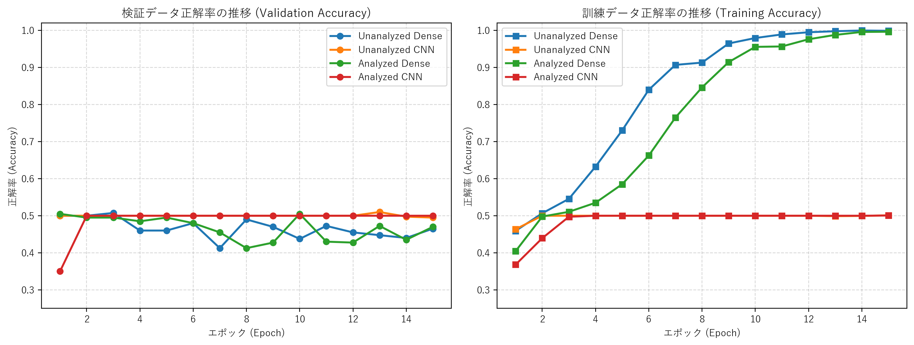
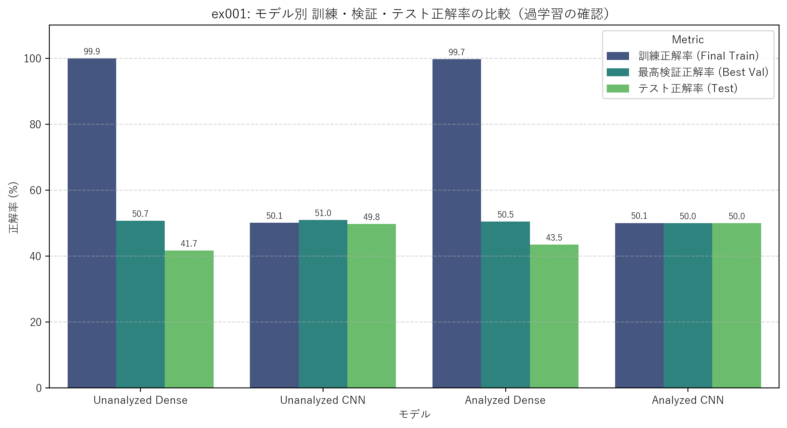
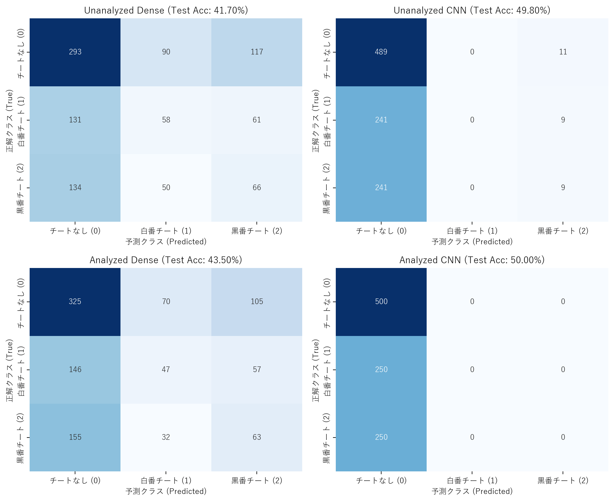

# 実験1 (ex001): 論文再現実験レポート

## 1. 実験の目的

本実験では，Reyhan Patria らによる論文 **"Cheat Detection on Online Chess Games using Convolutional and Dense Neural Network"**（ISRITI 2021）の提案手法を PyTorch（GPU 環境）上で忠実に再現し，4種類のニューラルネットワークモデルの性能と学習挙動を検証する．

対象論文は，盤面配置の時系列のみを用いる **未解析データ（Unanalyzed Data）** と，チェスエンジン（Stockfish）による局面評価値および各手番後の残り持ち時間を付加した **解析済みデータ（Analyzed Data）** の 2 種類の入力に対し，全結合ネットワーク（Dense Neural Network）と 3 次元畳み込みネットワーク（3D Convolutional Neural Network）を比較している．

---

## 2. データセットと前処理仕様

Lichess 公開アーカイブおよび Lichess User API（`tosViolation` フラグ）により収集し，Stockfish 19 で全手解析を補完した実対局データセット（`datasets/chess_cheat_dataset.npz`）を使用した．

- **総対局数**: 5,000 対局（ユニークチーターユーザー 248 名，ユニーク非チーターユーザー 2,121 名）
- **クラス構成（3クラス分類）**:
  - クラス `0` (`Nobody cheats`): **2,500 対局**（50.0% — 白黒とも非チーター）
  - クラス `1` (`White cheats`): **1,250 対局**（25.0% — 白番のみチーター）
  - クラス `2` (`Black cheats`): **1,250 対局**（25.0% — 黒番のみチーター）
- **入力テンソル表現**:
  - 盤面テンソル $X_{\mathrm{board}} \in \{0, 1\}^{N \times 80 \times 14 \times 8 \times 8}$: 先頭最大 80 プライ（80手）を対象とし，80手に満たない対局は残りを 0 でパディングする．14 チャンネルは「白の6駒種＋白全駒」および「黒の6駒種＋黒全駒」の one-hot 盤面表現に対応する．本データセットの 80 プライ上限内での平均手数は $62.20 \pm 18.80$ プライであった．
  - 解析特徴量テンソル $X_{\mathrm{analyzed}} \in \mathbb{R}^{N \times 80 \times 2}$: 各手番直後の Stockfish 白番視点評価値（ポーン単位，メイトは $\pm 100.0$）と残り持ち時間（秒単位）を格納する．
- **データ分割（論文 Section IV 準拠）**:
  - 層化ランダム分割（`seed=42`）により，まず全 5,000 対局を訓練側 80%（4,000 対局）とテスト 20%（1,000 対局：クラス0が 500 局，クラス1・2が各 250 局）に分割した．
  - さらに訓練側 4,000 対局のうち 10%（400 対局）を検証（Validation），残り 3,600 対局を学習（Train）に使用した．

---

## 3. プログラム構成とモデルアーキテクチャ

実験1のプログラムは以下のファイルで構成されている．

- [model.py](../ex001/model.py): 論文 Fig. 5 に基づく 4 モデルの定義
- [utils.py](../ex001/utils.py): データ分割，10バッチ/エポックの `DataLoader` 生成，GPU 学習・評価ループ，およびグラフ描画関数
- [ex001.ipynb](../ex001/ex001.ipynb): 実行済み実験ノートブック（GPU: NVIDIA GeForce RTX 4080）

### 3.1 再現モデルの概要

| モデル名 | 入力データ | 盤面エンコーダ構造 | 解析特徴量ブランチ | 結合・出力層 | パラメータ数 |
| :--- | :--- | :--- | :--- | :--- | ---: |
| **Unanalyzed Dense** | $X_{\mathrm{board}}$ | Flatten(71680) → 512 → 256 → 64 ($\mathrm{ReLU}$) | なし | $\mathrm{Dropout}(0.2)$ → Linear(64, 3) | 36,848,643 |
| **Unanalyzed CNN** | $X_{\mathrm{board}}$ | Permute → 3×$\mathrm{Conv3D}$(32, 64, 128; $3\times 3\times 3$) → Flatten(37888) → 32 | なし | $\mathrm{Dropout}(0.2)$ → Linear(32, 3) | 1,501,347 |
| **Analyzed Dense** | `X_board`, `X_analyzed` | Flatten(71680) → 512 → 256 → 64 ($\mathrm{ReLU}$) | Flatten(160) → 512 → 512 → 64 | $\mathrm{Concat}$(128) → $\mathrm{Dropout}(0.2)$ → Linear(128, 3) | 37,226,755 |
| **Analyzed CNN** | `X_board`, `X_analyzed` | 3×$\mathrm{Conv3D}$(32, 64, 128; $3\times 3\times 3$) → Flatten(37888) → 32 | Flatten(160) → 512 → 512 → 64 | $\mathrm{Concat}$(96) → $\mathrm{Dropout}(0.2)$ → Linear(96, 3) | 1,879,459 |

PyTorch の $\mathrm{Conv3d}$ はチャネルファースト形式 $(B, C, D, H, W)$ を要求するため，入力 $(B, 80, 14, 8, 8)$ を $(B, 14, 80, 8, 8)$ へ並べ替え，空間次元 $(80, 8, 8)$ に対して $3 \times 3 \times 3$ カーネル（パディングなし）を 3 層適用することで $(74, 2, 2, 128)$ すなわち 37,888 次元の特徴ベクトルを得る．

### 3.2 学習条件

論文 Section IV の設定に忠実に準拠し，全モデル共通で以下を用いた．

- **最適化手法**: Adam（学習率 $\eta = 0.001$）
- **損失関数**: 交差エントロピー損失（$\mathrm{CrossEntropyLoss}$）
- **エポック数**: 15 エポック
- **バッチ構成**: 1 エポックあたり 10 バッチ（訓練データ 3,600 件に対し `batch_size = 360`，総パラメータ更新ステップ数 150 回）

---

## 4. 実験結果

### 4.1 定量評価サマリ

GPU（RTX 4080）上で全 4 モデルを学習・評価した結果を下表に示す．

| モデル名 | パラメータ数 | 最終訓練正解率 (%) | 最高検証正解率 (%) | 最終検証正解率 (%) | テスト正解率 (%) | Macro F1 (%) | 過学習ギャップ (%pt) | 学習時間 (s) |
| :--- | ---: | ---: | ---: | ---: | ---: | ---: | ---: | ---: |
| **Unanalyzed Dense** | 36,848,643 | 99.92 | 50.75 | 46.50 | 41.70 | 36.00 | 53.42 | 9.57 |
| **Unanalyzed CNN** | 1,501,347 | 50.11 | 51.00 | 49.50 | 49.80 | 24.31 | 0.61 | 12.93 |
| **Analyzed Dense** | 37,226,755 | 99.67 | 50.50 | 47.00 | 43.50 | 35.94 | 52.67 | 9.95 |
| **Analyzed CNN** | 1,879,459 | 50.06 | 50.00 | 50.00 | **50.00** | 22.22 | 0.06 | 13.26 |

※ 過学習ギャップは「最終訓練正解率 − 最終検証正解率（%pt）」として算出している．

### 4.2 クラス別分類性能（テストデータ 1,000 件）

| モデル名 | Nobody cheats (500) F1 | White cheats (250) F1 | Black cheats (250) F1 | Weighted F1 |
| :--- | ---: | ---: | ---: | ---: |
| **Unanalyzed Dense** | 0.5539 | 0.2589 | 0.2672 | 0.4085 |
| **Unanalyzed CNN** | 0.6649 | 0.0000 | 0.0645 | 0.3486 |
| **Analyzed Dense** | 0.5773 | 0.2356 | 0.2653 | 0.4138 |
| **Analyzed CNN** | 0.6667 | 0.0000 | 0.0000 | 0.3333 |

### 4.3 学習曲線と混同行列

---

## 5. 考察と論文結果との比較

1. **Dense モデルにおける深刻な過学習の再現**
   - 論文では全モデルの訓練精度が約 97% に達する一方，検証・テスト精度は 48.75%〜57.50% に留まる深刻な過学習（Section V.C）が報告された．
   - 本再現実験においても，**Unanalyzed Dense**（訓練 99.92% vs テスト 41.70%，ギャップ 53.42%pt）および **Analyzed Dense**（訓練 99.67% vs テスト 43.50%，ギャップ 52.67%pt）で全く同様の現象が再現された．これは，71,680 次元もの疎な盤面配列に対して約 3,700 万パラメータを直接接続したことで，未知対局へ汎化する特徴ではなく訓練対局固有の盤面配置を丸暗記（Memorization）してしまったことが原因である．

2. **解析特徴量の追加によるテスト精度への寄与**
   - Dense モデル同士の比較では，**Unanalyzed Dense**（テスト精度 41.70%）に対し，Stockfish 評価値と持ち時間を追加した **Analyzed Dense**（テスト精度 43.50%）が +1.80%pt 上回った．これは「解析データの付加がモデル精度を底上げする」という論文の結論と整合している．
   - しかしながら，論文 Section IV で考察されている通り，盤面側入力が 71,680 次元であるのに対し解析側入力は 160 次元とスケール・次元数ともに非対称であり，さらに生値（持ち時間 0〜1,800 秒，評価値 −100〜+100）が未正規化のまま投入されているため，十分な相乗効果を引き出せていない．

3. **3D CNN モデルにおける多数派クラス崩壊（Majority-Class Collapse）の発見**
   - 論文では Accuracy のみが評価指標として報告され，CNN（57.2%〜57.5%）が Dense（48.75%〜56.25%）を上回ったと結論付けられていた．
   - 本実験でも Accuracy のみを見れば **Analyzed CNN**（50.00%）および **Unanalyzed CNN**（49.80%）が Dense モデルを上回った．しかし，**Macro F1 および混同行列を詳しく分析すると，3D CNN は実質的にクラス 0（Nobody cheats，データセットの 50.0% を占める多数派クラス）のみを予測する局所最適解に陥っている** ことが判明した．
   - その要因として，① バッチ正規化（$\mathrm{BatchNorm}$）を含まない 3 層 3D 畳み込み構造，② 1 エポック 10 バッチ・15 エポック（計 150 ステップのみ）という極めて少ないパラメータ更新回数，③ クラス比率 2:1:1 の不均衡のもとで未正規化の数値（持ち時間等）が入力されたことによる勾配の不安定化，の 3 点が挙げられる．

以上の知見より，単純に論文のネットワークと学習条件を適用するだけでは実用に耐えるチート検出器は得られないことが明らかとなった．次の [実験2 (ex002.md)](ex002.md) では，盤面高次元表現の正則化・圧縮と，ドメイン特化型の解析特徴量エンジニアリングおよび適切な正規化を導入し，過学習の抑制と実質的な 3 クラス識別性能（Macro F1 および Test Accuracy）の向上を検証する．
