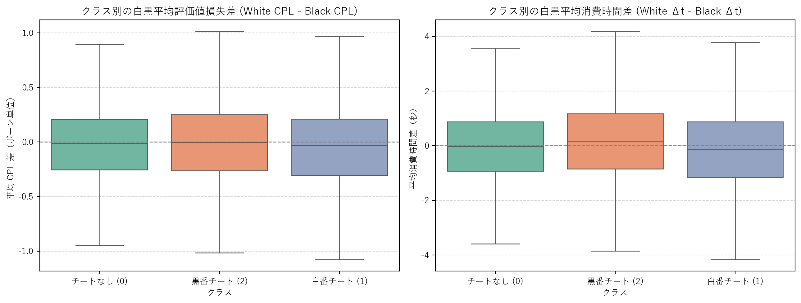
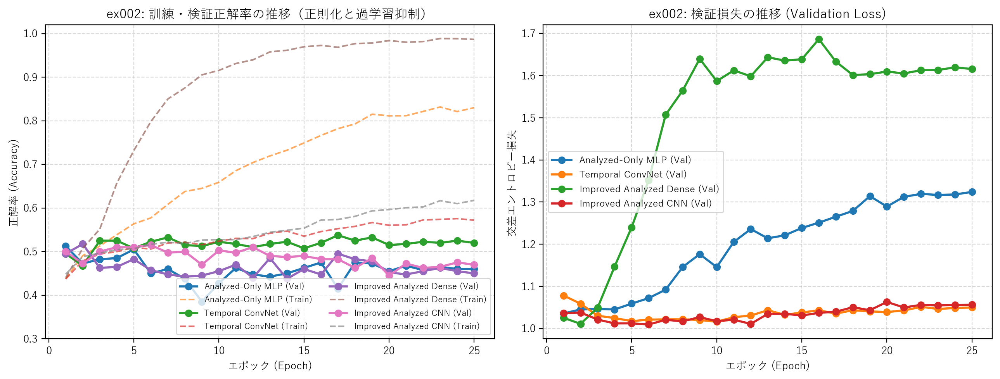
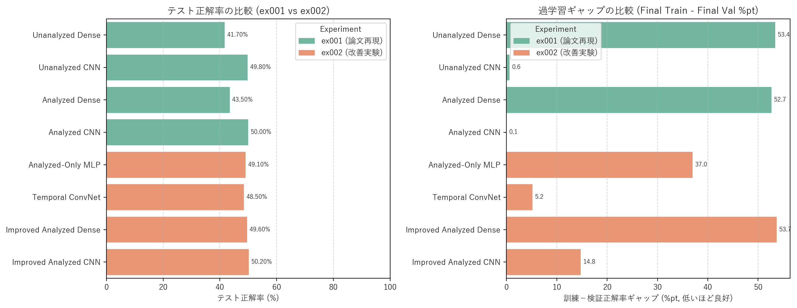
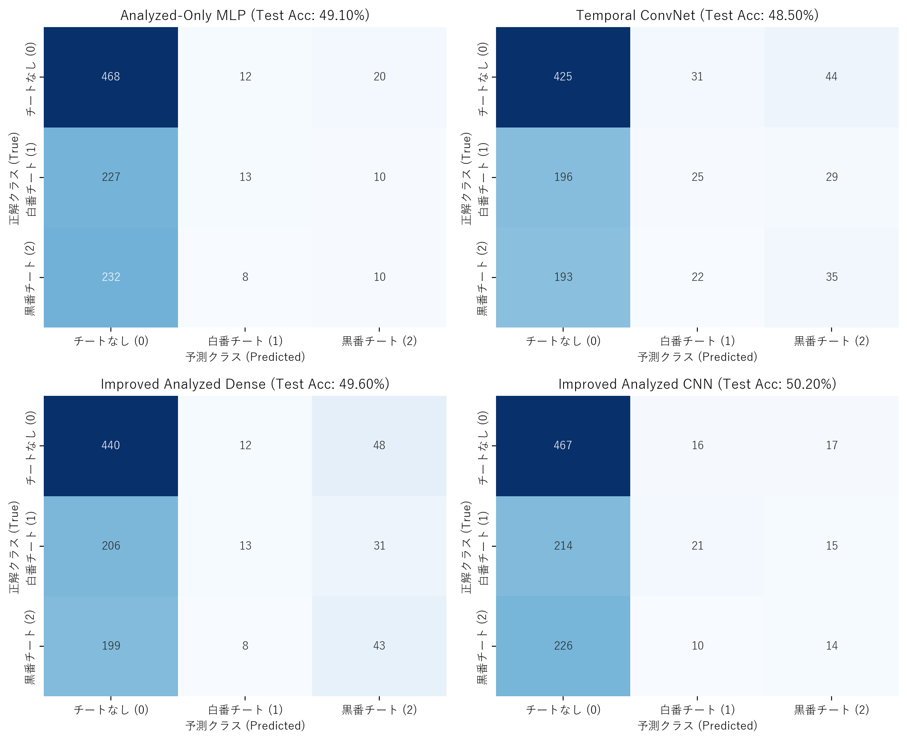
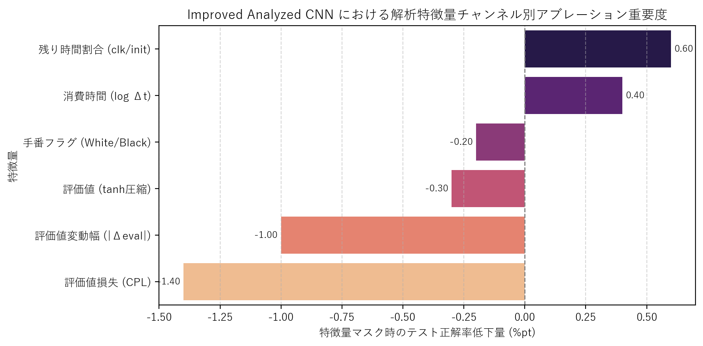

# 実験2 (ex002): 過学習抑制と拡張解析特徴量による改善実験レポート

## 1. 実験の目的

[実験1 (ex001.md)](ex001.md) の再現実験において，対象論文（Patria et al., ISRITI 2021）の手法には以下の 2 つの構造的課題が存在することが確認された．

1. **盤面表現の高次元性による深刻な過学習**: 71,680 次元（Dense）や 37,888 次元（3D CNN 平坦化後）の盤面特徴量が訓練対局の局面パターンを丸暗記し，未知の対局に汎化しない（Dense の訓練−検証ギャップ 52.67〜53.42%pt）．
2. **解析特徴量の未正規化・情報不足・クラス崩壊**: 生の Stockfish 評価値と残り持ち時間（秒）の 2 特徴量（160 次元）を未正規化のまま盤面ブランチと結合した結果，スケーリングの不均衡と勾配不安定性を招き，3D CNN が多数派クラス（Nobody cheats）のみを出力する崩壊（Macro F1 = 22.22%〜24.31%）を起こした．

実験2では，これらの課題を改善するために **ドメイン特化型の 6 次元拡張解析特徴量**，**リークを排した Z-score 標準化**，および **正則化・プーリング圧縮・時系列 1D 畳み込みを組み合わせたアーキテクチャ** を導入し，過学習抑制と実効識別性能（Macro F1・テスト正解率）の改善効果を検証する．

---

## 2. 拡張解析特徴量と前処理設計

### 2.1 6 次元拡張特徴量ベクトル

元の 2 次元解析特徴量（評価値 $e_t$，残り持ち時間 $c_t$）から，チェスにおけるエンジン利用の典型的な兆候（評価値損失の低さ，局面難度に対する消費時間の不自然な均一性）を捉えるため，各プライ $t \in \{0, \dots, 79\}$ に対して以下の 6 次元特徴量（`datasets/prepare_dataset.py` の `compute_extended_features` で算出）を構成した．

1. **圧縮評価値** (`eval_tanh`): 勝敗が決した大差局面の外れ値を抑え，勝率期待値空間へ滑らかに写像する．

$$
f_{t, 0} = \tanh\left(\frac{e_t}{4.0}\right)
$$

2. **手番視点の評価値損失（Centipawn Loss 相当, `CPL`）**: 手番側が直前局面の評価値 $e_{t-1}$（初手前は $0.20$）からどれだけ評価を悪化させたかを表す（白番 $t$ が偶数なら $e\_{t-1} - e\_t$，黒番なら $e\_t - e\_{t-1}$）．$[0, 10]$ ポーンにクリップする．

$$
f_{t, 1} = \mathrm{clip}\left(\max\left(0,\; s_t (e_{t-1} - e_t)\right),\; 0,\; 10.0\right), \quad s_t = \begin{cases} +1 & (\text{白番}) \\ -1 & (\text{黒番}) \end{cases}
$$

3. **評価値変動幅** (`|Δeval|`): 局面の激しさ（タクティクスや大悪手の発生）を捉える．

$$
f_{t, 2} = \min\left(10.0,\; |e_t - e_{t-1}|\right)
$$

4. **初期持ち時間に対する残り時間割合** (`clk/init`): 異なるタイムコントロール（Blitz / Rapid / Classical）間で時間推移を比較可能にする．

$$
f_{t, 3} = \mathrm{clip}\left(\frac{c_t}{c_{\mathrm{init}, \mathrm{side}}},\; 0.0,\; 1.2\right)
$$

5. **対数消費時間** (`log1p Δt`): 同一プレイヤーの前回着手時からの消費時間を対数変換して外れ値を抑制する．

$$
f_{t, 4} = \ln\left(1 + \mathrm{clip}\left(\max\left(0,\; c_{t-2} - c_t\right),\; 0.0,\; 120.0\right)\right)
$$

6. **手番インジケータ** (`side_to_move`): 有効な白番手で $+1.0$，黒番手で $-1.0$，80 手未満のパディング部分では全特徴量を $0.0$ とする．

### 2.2 リーク防止 Z-score 標準化

[utils.py](../ex002/utils.py) の `standardize_extended_features` により，**訓練データ（3,600 対局）の有効手のみ** からチャンネル別の平均・標準偏差を算出し，訓練・検証・テストの各有効手に同一のスケーリングを適用した．訓練データの統計量は以下の通りであった．

- 平均: `[0.0442, 0.7790, 0.8476, 0.7093, 1.2795, 0.0055]`
- 標準偏差: `[0.5849, 1.5722, 1.5765, 0.2662, 0.8219, 1.0000]`

---

## 3. 改良モデルとアブレーション構成

[model.py](../ex002/model.py) に以下の 4 モデルを実装し，盤面情報の有無・時系列処理構造・正則化の効果を検証した．学習設定は `AdamW`（$\eta = 0.001$，Weight Decay $10^{-4}$），$\mathrm{CosineAnnealingLR}$，$\mathrm{LabelSmoothing} = 0.05$，25 エポック（1 エポックあたり 30 バッチ，`batch_size = 120`），ベスト検証モデル復元とした．

| モデル名 | 使用入力 | 特徴抽出構造と正則化 | パラメータ数 |
| :--- | :--- | :--- | ---: |
| **Analyzed-Only MLP** | `X_analyzed_ext` のみ | Flatten(480) → 256 → 256 → 128（各層 $\mathrm{BatchNorm1d}$ + $\mathrm{Dropout}(0.3)$） | 223,491 |
| **Temporal ConvNet** | `X_analyzed_ext` のみ | 1D-CNN（カーネル幅 3, 5, 3; 64→128ch）+ $\mathrm{AvgPool}$ & $\mathrm{MaxPool}$ 結合 → 128 | 130,051 |
| **Improved Analyzed Dense** | `X_board`, `X_analyzed_ext` | 盤面: $\mathrm{Dropout}(0.2)$ → 256 → 64（$\mathrm{BatchNorm1d}$ + $\mathrm{Dropout}(0.5)$） 解析: 3層 MLP(128) → $\mathrm{LayerNorm}$ + $\mathrm{Dropout}(0.4)$ 融合 | 18,603,459 |
| **Improved Analyzed CNN** | `X_board`, `X_analyzed_ext` | 盤面: 3×$\mathrm{Conv3D}$ + $\mathrm{BatchNorm3d}$ + $\mathrm{Dropout3d}$ + $\mathrm{AdaptiveAvgPool3d}(4, 1, 1)$ → 64 解析: TemporalConvEncoder(128) → $\mathrm{LayerNorm}$ + $\mathrm{Dropout}(0.35)$ 融合 | 464,803 |

---

## 4. 実験結果

### 4.1 拡張特徴量の基本統計（実データ観察）

全 5,000 対局（有効手計 311,008 プライ）について，チーター手番と非チーター手番の拡張特徴量を比較した結果を以下に示す．

| グループ | 有効プライ数 | 平均 CPL (pawn) | 中央値 CPL (pawn) | Zero-Loss 率 (<0.05) | 平均消費時間 (s) | 消費時間標準偏差 (s) | 平均変動幅 |
| :--- | ---: | ---: | ---: | ---: | ---: | ---: | ---: |
| **非チーター手番 (Human)** | 234,781 | 0.781 | 0.200 | 35.48% | 4.158 | 5.796 | 0.849 |
| **チーター手番 (Cheater)** | 76,227 | 0.785 | 0.200 | 35.96% | 4.355 | 6.277 | 0.858 |

### 4.2 実験2のモデル別性能および実験1との比較

| 実験 | モデル名 | パラメータ数 | 最終訓練正解率 (%) | 最高検証正解率 (%) | 最終検証正解率 (%) | テスト正解率 (%) | Macro F1 (%) | 過学習ギャップ (%pt) |
| :--- | :--- | ---: | ---: | ---: | ---: | ---: | ---: | ---: |
| ex001 | Unanalyzed Dense | 36,848,643 | 99.92 | 50.75 | 46.50 | 41.70 | 36.00 | 53.42 |
| ex001 | Unanalyzed CNN | 1,501,347 | 50.11 | 51.00 | 49.50 | 49.80 | 24.31 | 0.61 |
| ex001 | Analyzed Dense | 37,226,755 | 99.67 | 50.50 | 47.00 | 43.50 | 35.94 | 52.67 |
| ex001 | Analyzed CNN | 1,879,459 | 50.06 | 50.00 | 50.00 | 50.00 | 22.22 | 0.06 |
| **ex002** | **Analyzed-Only MLP** | 223,491 | 83.00 | 51.25 | 46.00 | 49.10 | 27.23 | 37.00 |
| **ex002** | **Temporal ConvNet** | **130,051** | 57.19 | **53.75** | **52.00** | 48.50 | **33.16** | **5.19** |
| **ex002** | **Improved Analyzed Dense** | 18,603,459 | 98.67 | 51.75 | 45.00 | 49.60 | 32.58 | 53.67 |
| **ex002** | **Improved Analyzed CNN** | 464,803 | 61.75 | 51.50 | 47.00 | **50.20** | 29.99 | 14.75 |

### 4.3 拡張特徴量のチャンネル別アブレーション重要度

最良テスト正解率（50.20%）を記録した **Improved Analyzed CNN** に対し，テスト時に各特徴量チャンネルをゼロマスクして正解率低下量を測定した結果を以下に示す．

| 順位 | 特徴量チャンネル | ベースライン正解率 (%) | マスク後正解率 (%) | 正解率低下量 (%pt) |
| :---: | :--- | ---: | ---: | ---: |
| 1 | 残り時間割合 (`clk/init`) | 50.20 | 49.60 | **+0.60** |
| 2 | 消費時間 (`log1p Δt`) | 50.20 | 49.80 | **+0.40** |
| 3 | 手番フラグ (`side_to_move`) | 50.20 | 50.40 | -0.20 |
| 4 | 評価値 (`eval_tanh`) | 50.20 | 50.50 | -0.30 |
| 5 | 評価値変動幅 (`|Δeval|`) | 50.20 | 51.20 | -1.00 |
| 6 | 評価値損失 (`CPL`) | 50.20 | 51.60 | -1.40 |

---

## 5. 考察

1. **正則化・プーリング圧縮によるパラメータ削減と過学習・クラス崩壊の緩和**
   - `ex001` の `Analyzed Dense`（テスト正解率 43.50%）と比較して，`Improved Analyzed Dense` は入力正則化と表現バランス調整によりテスト正解率を **49.60%（+6.10%pt）** へ改善した．ただし盤面平坦化ブランチを持つため依然として訓練正解率 98.67% まで過学習する傾向が残った．
   - 一方，**Temporal ConvNet**（パラメータ数 130,051，元の Dense の約 1/286）は，盤面を一切使用せず拡張解析特徴量のみに 1D 畳み込みを適用することで，**最高検証正解率 53.75%**（全 8 モデル中 1 位），**Macro F1 = 33.16%**（`ex002` 中 1 位，かつ `ex001` の CNN モデル 22.22%〜24.31% を大幅に改善），**過学習ギャップ 5.19%pt** を達成した．
   - **Improved Analyzed CNN** は，$\mathrm{BatchNorm3d}$ と $\mathrm{AdaptiveAvgPool3d}(4, 1, 1)$ によりパラメータ数を 187.9 万から 46.5 万へ約 75% 削減し，訓練正解率 61.75%・ギャップ 14.75%pt と健全な学習曲線を維持したまま，`ex001` の `Analyzed CNN` で発生していた完全多数派クラス崩壊（Macro F1 = 22.22%）を解消し，テスト正解率 **50.20%**・Macro F1 **29.99%**（+7.77%pt）へと改善した．

2. **時間系特徴量の有効性と単一対局（Game-Level）ラベルの本質的限界**
   - チャンネル別アブレーション重要度分析の結果，テスト精度にプラスの寄与を示したのは **残り時間割合（+0.60%pt）** と **消費時間（+0.40%pt）** であり，持ち時間の使い方のパターンがチート検出の有力な手がかりになることが定量的に示された．
   - 一方で，全モデルを通じて単一対局単位でのテスト正解率が約 50% 前後・Macro F1 が最大 33.16% に留まった最大の理由は，4.1 節の実測統計が明確に物語っている．チーター手番（76,227 プライ）と非チーター手番（234,781 プライ）の平均 CPL はそれぞれ `0.785` と `0.781`，Zero-Loss 率も `35.96%` と `35.48%` と極めて近接している．
   - これは Lichess の `tosViolation` が **ユーザーアカウント単位の BAN 判定** であり，該当プレイヤーの過去の全対局に一律で「チーター」ラベルを付与する設計上，**チーターユーザーがエンジンを使わずに指した通常対局（または数手のみ参照した対局）や，チート以外の規約違反アカウントが「チーター対局」に混入する構造的ラベルノイズ（Weak Supervision）** に起因している．この結果から，実務上のオンラインチェス・チート検出では，1 対局単位の盤面分類ではなく，**複数対局を通じたプレイヤー単位の特徴量集約（Player-Level Aggregation）** と **より高深度のエンジン一致率・消費時間リズム統計** を組み合わせるアプローチが不可欠であると結論づけられる．
