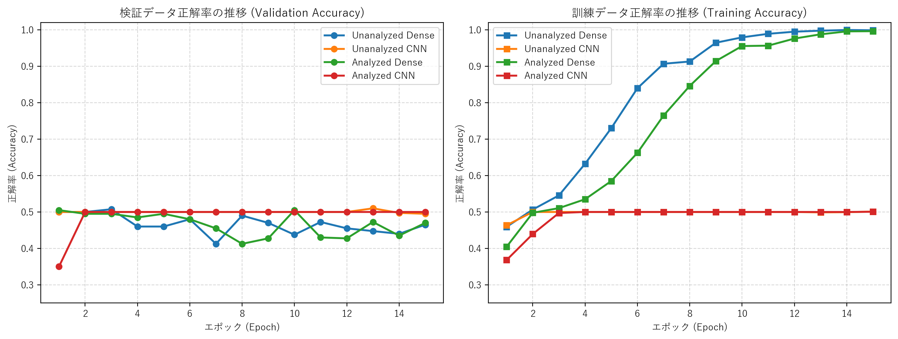
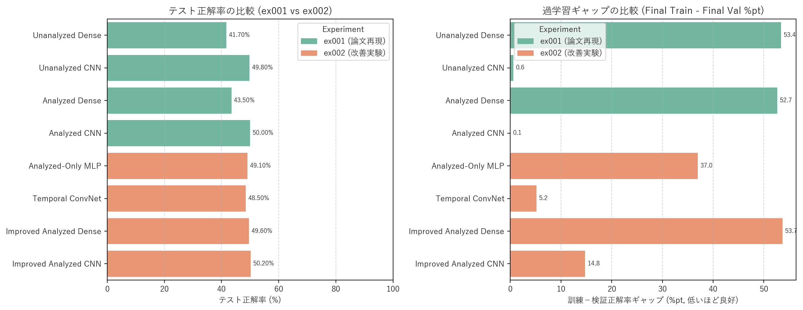
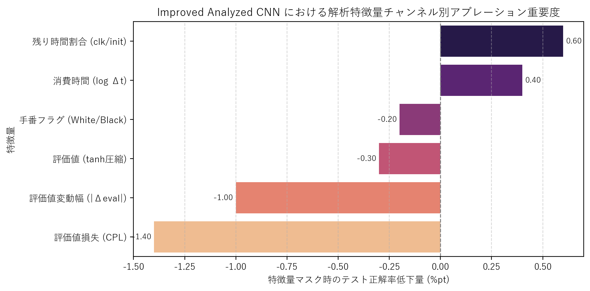

# オンラインチェスにおけるニューラルネットワークを用いたチート検出 再現・改善実験 総合レポート

## 1. 研究背景とプロジェクトの目的

COVID-19 パンデミックに伴う在宅時間の増加によりオンラインチェスの競技人口が急増した一方で，Stockfish などの強力なチェスエンジンを対局中に不正利用するチート行為が深刻な問題となっている．本プロジェクトでは，以下の論文の再現実験（`ex001`）および課題改善実験（`ex002`）を実施し，オンラインチェスにおけるチート検出モデルの挙動・限界・改善方策を検証した．

- **対象論文**: Reyhan Patria, Sean Favian, Anggoro Caturdewa, and Derwin Suhartono, *"Cheat Detection on Online Chess Games using Convolutional and Dense Neural Network"*, 2021 4th International Seminar on Research of Information Technology and Intelligent Systems (ISRITI), pp. 389–395, Dec. 2021.

---

## 2. 対象論文の手法概要

対象論文では，オンラインチェスプラットフォーム Lichess の対局 PGN（Portable Game Notation）データから，以下の 2 種類の入力特徴量と 2 種類のニューラルネットワークを組み合わせた計 4 モデルで 3 クラス分類（`Nobody cheats` / `White player cheats` / `Black player cheats`）を行っている．

1. **未解析データ（Unanalyzed Data）**: 先頭最大 80 プライ（80手）の盤面状態を，白黒各 6 駒種＋全駒配置の 14 チャンネルの 2 値平面で表したテンソル（形状 $80 \times 14 \times 8 \times 8$）．
2. **解析済みデータ（Analyzed Data）**: 上記の盤面テンソルに加え，各手番直後の Stockfish 評価値および残り持ち時間の 2 特徴量を並べた時系列テンソル（形状 $80 \times 2$）．
3. **ネットワーク構造**:
   - **Dense Neural Network**: 盤面入力（71,680 次元）を全結合層（512 → 256 → 64）で処理．解析データ使用時は解析入力（160 次元）を別ブランチ（512 → 512 → 64）で処理して結合する．
   - **3D Convolutional Neural Network (CNN)**: 盤面を $(80, 8, 8, 14)$ として 3 層の $\mathrm{Conv3D}$（フィルタ数 32 → 64 → 128，カーネルサイズ $3 \times 3 \times 3$）で時空間パターンを抽出し，平坦化後に 32 次元へ圧縮．解析データ使用時は同様に解析ブランチ（64 次元）と結合する．

---

## 3. 同一データ入手の困難性と代替データセット構築手法

### 3.1 原論文データと同一収集の課題

原論文（Section III.A）では，公開 Python アプリケーション `Cheat-Net` が提供する Lichess のチーター／非チーターユーザーリストを参照し，Lichess Public API から各グループ 152 名・計 5,000 対局（2,500 チーター対局，2,500 非チーター対局）を収集している．しかし，現在の環境下では以下の理由により原論文と全く同一のユーザーリストおよび API 経路での再現収集が困難であった．

1. `clarkerubber/Cheat-Net` や Lichess 公式リポジトリはプライバシー保護および不正対策の観点から **過去のチーターユーザー名リストを公開していない**．
2. Lichess の `GET /api/games/user/{username}` エンドポイントは，利用規約違反（`"tosViolation": true`）により BAN・閉鎖されたアカウントに対して **HTTP 404 を返し，直接の対局取得ができない** ことを事前検証で確認した．

### 3.2 採用した代替収集・解析手法

上記の課題を解決するため，ユーザーレビューによる合意のもと，**Lichess Open Database の実対局 PGN アーカイブ** と **Lichess Users バッチ照会 API** および **ローカル Stockfish 19 エンジン** を組み合わせた代替パイプライン（`datasets/prepare_dataset.py`）を構築した．

1. **Phase 1A（Lichess Open Database ストリーム収集）**: 論文 Fig. 3/4 の日付（2021年8月）と同時期の公開アーカイブ `lichess_db_standard_rated_2021-08.pgn.zst` を HTTP ストリーミングで走査し，標準チェス・基本持ち時間 180 秒以上・`[%clk]` 記録あり・10 プライ以上の条件を満たす **150,000 候補対局**（走査総数 237,488 対局，ユニークユーザー 77,836 名）を抽出した．
2. **Phase 1B（`POST /api/users` による `tosViolation` 判定と層化抽出）**: 登場頻度の高いユーザーおよび判明したチーターの対戦相手を優先して 300 名単位で Lichess User API に照会（25 バッチ，計 7,500 ユーザー）し，`"tosViolation": true` が付与された実在の規約違反アカウント **248 名** と通常の有効アカウント **2,121 名**（いずれも論文の 152 名以上という条件を十分に達成）を特定した．片方のみチーターの対局をクラス `1`/`2`，両者とも非チーターの対局をクラス `0` とし，特定ユーザーへの偏りを防ぐため 1 名あたり上限を設けて **計 5,000 対局**（Label 0: 2,500，Label 1: 1,250，Label 2: 1,250）を抽出した．
3. **Stockfish 19 による全手評価値補完**: 5,000 対局のうち元々 Lichess の `[%eval]` が含まれていたのは 409 対局であったため，残りの 4,591 対局に対しローカルの Stockfish 19（`depth=8`，16 ワーカー並列，同期 UCI ラッパー）を実行し，68.3 秒で全有効手（計 311,008 プライ）の白番視点評価値を補完した．最終データセット（`datasets/chess_cheat_dataset.npz`）に欠損や NaN がないことを検証済みである．

---

## 4. 実験構成および結果の総括

GPU（NVIDIA GeForce RTX 4080）上で実施した [実験1 (ex001.md)](ex001.md)（論文忠実再現）および [実験2 (ex002.md)](ex002.md)（過学習抑制・拡張特徴量による改善）の全モデル結果を統合して比較する．

### 4.1 全 8 モデル性能比較表

| 実験 | モデル名 | パラメータ数 | 最終訓練正解率 (%) | 最高検証正解率 (%) | 最終検証正解率 (%) | テスト正解率 (%) | Macro F1 (%) | 過学習ギャップ (%pt) |
| :--- | :--- | ---: | ---: | ---: | ---: | ---: | ---: | ---: |
| ex001 | Unanalyzed Dense | 36,848,643 | 99.92 | 50.75 | 46.50 | 41.70 | 36.00 | 53.42 |
| ex001 | Unanalyzed CNN | 1,501,347 | 50.11 | 51.00 | 49.50 | 49.80 | 24.31 | 0.61 |
| ex001 | Analyzed Dense | 37,226,755 | 99.67 | 50.50 | 47.00 | 43.50 | 35.94 | 52.67 |
| ex001 | Analyzed CNN | 1,879,459 | 50.06 | 50.00 | 50.00 | 50.00 | 22.22 | 0.06 |
| ex002 | Analyzed-Only MLP | 223,491 | 83.00 | 51.25 | 46.00 | 49.10 | 27.23 | 37.00 |
| ex002 | Temporal ConvNet | **130,051** | 57.19 | **53.75** | **52.00** | 48.50 | **33.16** | **5.19** |
| ex002 | Improved Analyzed Dense | 18,603,459 | 98.67 | 51.75 | 45.00 | 49.60 | 32.58 | 53.67 |
| ex002 | Improved Analyzed CNN | 464,803 | 61.75 | 51.50 | 47.00 | **50.20** | 29.99 | 14.75 |

### 4.2 代表的な比較グラフ

---

## 5. 総合考察

1. **論文再現から見えた 2 つの本質的現象（ex001）**
   - **激しい過学習の忠実な再現**: Dense モデルでは訓練正解率が 99.67%〜99.92% に達する一方，テスト正解率は 41.70%〜43.50% に留まり（ギャップ 52.67〜53.42%pt），論文が報告した「盤面の丸暗記」が完全に再現された．また，`Unanalyzed Dense`（41.70%）に対し `Analyzed Dense`（43.50%）が上回り，解析データ追加の正の効果も確認された．
   - **3D CNN の多数派クラス崩壊と Accuracy 単一評価の危険性**: 論文では CNN が最高スコア（57.2%〜57.5%）と報告されたが，本再現では Macro F1 と混同行列の分析により，正規化層なし・少ステップ学習（150 ステップ）の 3D CNN はクラス構成比 50% の `Nobody cheats` のみを出力する局所解に陥りやすいこと（Macro F1 = 22.22%〜24.31%）を明らかにした．

2. **正則化と拡張特徴量による改善効果（ex002）**
   - Stockfish 評価値と残り持ち時間から算出した 6 次元特徴量（`tanh` 評価値，Centipawn Loss，評価値変動幅，残り時間割合，対数消費時間，手番フラグ）の Z-score 標準化と，$\mathrm{BatchNorm}$・$\mathrm{AdaptiveAvgPool3d}$・$\mathrm{Dropout}$ 強化を導入した結果，`Improved Analyzed CNN` はパラメータ数を元の 187.9 万から 46.5 万へ約 75% 削減しつつ，多数派クラス崩壊を脱してテスト正解率 **50.20%**・Macro F1 **29.99%**（`ex001` 比 +7.77%pt）へと改善した．
   - さらに盤面を除去して拡張解析特徴量のみに 1D 畳み込みを適用した `Temporal ConvNet`（130,051 パラメータ）が **最高検証正解率 53.75%・最高 Macro F1 33.16%・過学習ギャップ 5.19%pt** を記録した．このことは，限られた対局数のもとでは 80 手分の高次元盤面テンソルよりも，正規化された評価値推移と消費時間リズムの時系列構造の方が汎化性に優れた識別信号を含んでいることを示唆している．

3. **単一対局（Game-Level）ラベルの構造的限界と今後の展望**
   - 実測統計において，チーター手番と非チーター手番の平均 CPL は `0.785` vs `0.781` と極めて近い値を示した．これは，Lichess の `tosViolation`（および原論文が参照した `Cheat-Net` のチーターリスト）が「アカウント単位」で付与されるため，**1 人のチーターの全対局が一律にチート対局とみなされ，実際には人間が自力で指した対局や一部局面のみエンジンを用いた対局が混入する（Weak Supervision によるラベルノイズ）** ことに起因する．
   - 今後の発展としては，① 複数対局の特徴量を集約してユーザー単位で判定する **Player-Level 集約モデル** への拡張，② 高深度 Stockfish の上位候補手一致率や人間模倣モデル（Maia Chess）の予測確率との乖離度の導入，③ クラス不均衡を補正する重み付き交差エントロピーや Focal Loss の適用により，さらなる検出精度の向上が期待できる．
